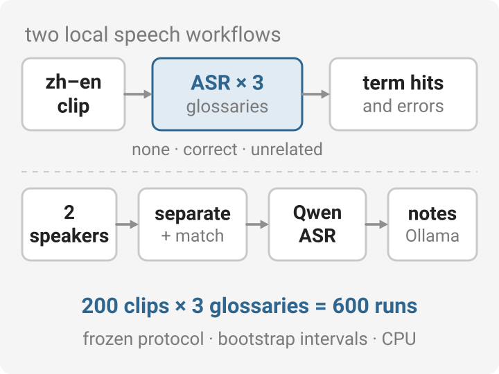

# Local Speaker Lab

[](https://github.com/HenryVarro666/local-speaker-lab/actions/workflows/tests.yml) · [MIT](LICENSE)

<p align="center">
  <picture>
    <source media="(prefers-color-scheme: dark)" srcset="docs/overview-dark.svg">
    
  </picture>
</p>

Propio 的本地语音实验代码，提供可复查的实验输入、模型运行和计分工具。核心实现位于 `src/speaker_lab/`，当前有两条工作流：

| 工作流 | 用途 | 入口 |
| --- | --- | --- |
| **单人中英混合词表实验 · 当前主要工作** | 同一批录音分别使用无词表、正确词表和无关词表，比较转写、术语命中与错误引入 | [实验说明](experiments/glossary/README.md) |
| 双人分离、转写与纪要 | 分段与重叠分离 → 人物匹配 → Qwen 转写与对齐 → Ollama 纪要；已有 Ubuntu 部署路线 | [双人工作流完整指南](docs/TWO_SPEAKER_GUIDE.md) |

先读 [快速开始](docs/GETTING_STARTED.md)，选择轻量开发检查、Windows CPU 词表实验或 Ubuntu 双人工作流。核心包要求 **Python 3.11 或更高版本**；Ubuntu 双人部署使用 **Python 3.12** 的独立模型环境及锁定依赖。

200 条录音 × 3 组的 CPU 词表实验已完成全部 600 次真实推理与配对核验。[冻结协议](experiments/glossary/protocols/ascend-val200-train-vocab30-v2/)提供词表、选中 ID 与分析计划；[正式结果](experiments/glossary/ASCEND_200_RESULTS.md)显示本轮未修复基线术语漏识，整体错误率的小幅下降尚不足以证明词表有效。复现入口见[实验说明](experiments/glossary/README.md)。

## 从这里继续

| 想做什么 | 文档 |
| --- | --- |
| 首次安装、运行检查或配置开发环境 | [GETTING_STARTED](docs/GETTING_STARTED.md) |
| 理解模块、环境与数据边界 | [ARCHITECTURE](docs/architecture.md) |
| 开发环境、轻量回归、CI 与源码打包 | [开发与验证](docs/development.md) |
| 阅读词表实验、复现固定对照 | [词表实验](experiments/glossary/README.md) |
| 部署双人工作流、理解音轨和纪要输出 | [TWO_SPEAKER_GUIDE](docs/TWO_SPEAKER_GUIDE.md) |
| 替换分离、识别、转写和 LLM 后端 | [模型接口](docs/model-backends.md) |
| 查看一键部署、升级与既有验证范围 | [DEPLOYMENT](DEPLOYMENT.md) · [DEPLOYMENT_REVIEW](DEPLOYMENT_REVIEW.md) |
| 修改代码、运行测试、维护实验记录 | [CONTRIBUTING](CONTRIBUTING.md) |
| 查看当前交付版本的改动 | [CHANGELOG](CHANGELOG.md) |
| 查看整体审查的问题、修复和证据边界 | [仓库审查](docs/repository-review.md) |
| 上游仓库、模型和数据引用及许可 | [THIRD_PARTY_NOTICES](THIRD_PARTY_NOTICES.md) |
| 区分现有实现、实测证据与下一步 | [ROADMAP](docs/ROADMAP.md) |

源码、配置和可审阅协议与本地大产物分别保存：模型及环境在 `.cache/`、`.venv*/` 或 `.venvs/`，录音与数据副本在实验数据目录，推理输出在 `runs/`。具体边界见[架构说明](docs/architecture.md#目录与产物边界)。

## Ubuntu 双人工作流：部署与升级

将发布的 ZIP、同名 `.sha256` 和独立 `deploy_ubuntu.sh` 放在同一目录。首次安装并验收一段录音：

```bash
bash deploy_ubuntu.sh --zip ./local-speaker-lab.zip --audio /absolute/path/two-speakers.wav
```

从 0.1.3 升级到 0.1.4，交互选择旧目录与新目录：

```bash
bash deploy_ubuntu.sh --upgrade --zip ./local-speaker-lab.zip --audio /absolute/path/two-speakers.wav
```

脚本保留旧版本，复用可用模型缓存，交互读取 `HF_TOKEN`，在失败时停止并脱敏保存日志，最后显示本次验收报告与失败日志的绝对路径。首次安装、驱动重启恢复、升级缓存策略与故障定位见[完整部署说明](docs/deployment.md)。

## 仓库布局

```text
src/speaker_lab/    核心流程、时轴、模型适配器、CLI 与 Gradio
configs/           可替换后端和实验配置
requirements/      分环境依赖与 Ubuntu/Python 3.12 锁文件
scripts/           安装、升级、诊断、验收和打包入口
tests/             契约、失败恢复、脱敏与流水线回归
docs/              架构、部署、接口、开发和验证说明
experiments/       独立实验说明与冻结协议
.github/           Windows/Ubuntu CI、Issue 与 PR 模板
```

轻量测试无需下载模型；真实 RTX 5080 推理通过目标机器上的验收流程检查。CI 的执行边界见[开发与验证](docs/development.md)。

## 上游与许可

本项目集成 [pyannote.audio](https://github.com/pyannote/pyannote-audio)、[ClearerVoice-Studio](https://github.com/modelscope/ClearerVoice-Studio)、[Qwen3-ASR](https://github.com/QwenLM/Qwen3-ASR)、[SpeechBrain](https://github.com/speechbrain/speechbrain)、[Ollama](https://github.com/ollama/ollama) 和 [Gradio](https://github.com/gradio-app/gradio)。原创编排与适配代码采用 MIT；第三方软件、模型和 ASCEND 数据保留各自许可。使用位置、官方模型卡、数据归属和论文链接见[上游说明](THIRD_PARTY_NOTICES.md)。源码发布不包含模型权重或语音数据。
