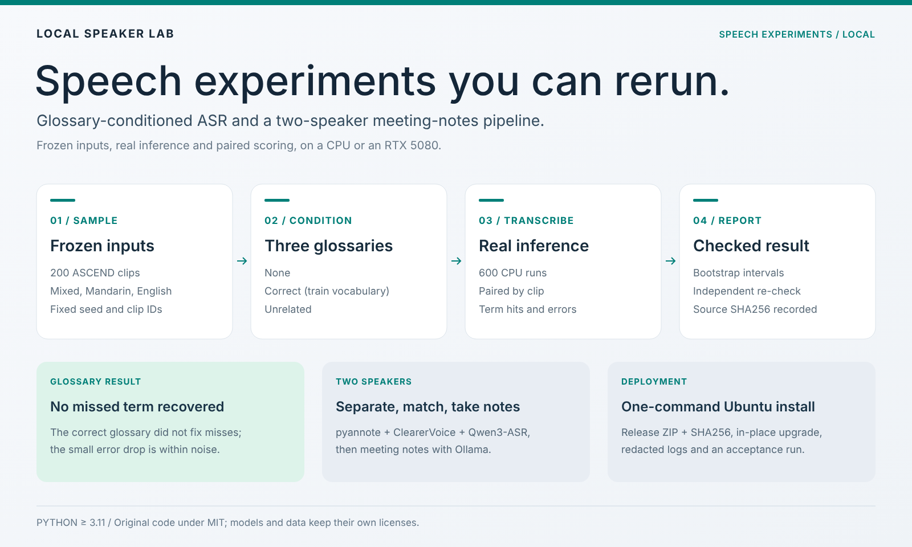
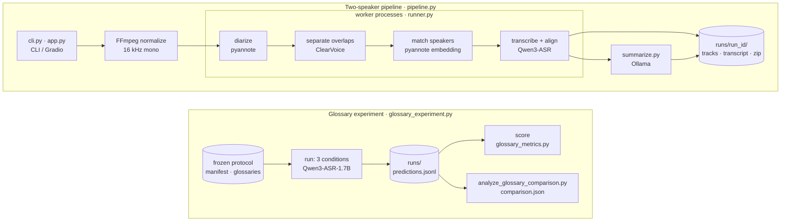

<div align="center">

# Local Speaker Lab

**English** · [简体中文](README.zh-CN.md)

**Reproducible local speech experiments: glossary-conditioned ASR and a two-speaker notes pipeline.**

[](https://github.com/HenryVarro666/local-speaker-lab/actions/workflows/tests.yml)

[](LICENSE)
[](https://www.ccao2679.com/projects/#local-speaker-lab)



</div>

Local speech-experiment code for Propio, with reviewable experiment inputs, model runs and scoring tools. The core implementation lives in `src/speaker_lab/` and currently serves two workflows:

| Workflow | Purpose | Entry point |
| --- | --- | --- |
| **Single-speaker Mandarin–English glossary experiment · current focus** | Runs the same recordings with no glossary, the correct glossary and an unrelated glossary, then compares transcripts, term hits and newly introduced errors | [Experiment guide](experiments/glossary/README.md) |
| Two-speaker separation, transcription and notes | Segmentation and overlap separation → speaker matching → Qwen transcription and alignment → Ollama notes; an Ubuntu deployment path is in place | [Full two-speaker guide](docs/TWO_SPEAKER_GUIDE.md) |

Start with [Getting started](docs/GETTING_STARTED.md) and pick a path: lightweight development checks, the Windows CPU glossary experiment, or the Ubuntu two-speaker workflow. The core package requires **Python 3.11 or later**; the Ubuntu two-speaker deployment uses separate **Python 3.12** model environments with locked dependencies.

The CPU glossary experiment (200 recordings × 3 conditions) has completed all 600 real inference runs and their paired verification. The [frozen protocol](experiments/glossary/protocols/ascend-val200-train-vocab30-v2/) provides the glossaries, selected IDs and analysis plan; the [formal results](experiments/glossary/ASCEND_200_RESULTS.md) show that this round did not fix the baseline's missed terms, and the small drop in overall error rate is not enough to show that the glossary helps. See the [experiment guide](experiments/glossary/README.md) to reproduce it.

## Architecture



The two groups are the two workflows; both live in `src/speaker_lab/` and write their results under `runs/`. The glossary experiment loads one Qwen3-ASR model in-process, runs every clip under three conditions (no glossary, correct glossary, unrelated glossary), and scores and compares the saved predictions only after the run. The two-speaker pipeline runs each model stage as a separate worker process (`runner.py` → `worker.py`, one interpreter per stage set in `configs/default.toml`); separation and matching apply only to detected overlaps, and if the Ollama summary fails, the tracks and transcript are still kept.

## Where to go next

| Goal | Document |
| --- | --- |
| First install, run checks or set up a development environment | [GETTING_STARTED](docs/GETTING_STARTED.md) |
| Understand modules, environments and data boundaries | [ARCHITECTURE](docs/architecture.md) |
| Development environment, lightweight regression tests, CI and source packaging | [Development and verification](docs/development.md) |
| Read the glossary experiment and reproduce the fixed comparison | [Glossary experiment](experiments/glossary/README.md) |
| Deploy the two-speaker workflow and understand its tracks and notes output | [TWO_SPEAKER_GUIDE](docs/TWO_SPEAKER_GUIDE.md) |
| Swap separation, recognition, transcription and LLM backends | [Model interfaces](docs/model-backends.md) |
| One-command deployment, upgrades and the scope of existing verification | [DEPLOYMENT](DEPLOYMENT.md) · [DEPLOYMENT_REVIEW](DEPLOYMENT_REVIEW.md) |
| Change code, run tests and maintain experiment records | [CONTRIBUTING](CONTRIBUTING.md) |
| See what changed in the current release | [CHANGELOG](CHANGELOG.md) |
| See the issues, fixes and evidence boundaries from the full repository review | [Repository review](docs/repository-review.md) |
| Upstream repositories, models, data citations and licenses | [THIRD_PARTY_NOTICES](THIRD_PARTY_NOTICES.md) |
| Separate what is implemented, what has been measured and what comes next | [ROADMAP](docs/ROADMAP.md) |

Source code, configs and reviewable protocols are stored apart from large local artifacts: models and environments live in `.cache/`, `.venv*/` or `.venvs/`, recordings and data copies in the experiment data directories, and inference outputs in `runs/`. See the [architecture notes](docs/architecture.md#目录与产物边界) for the exact boundaries.

## Two-speaker workflow on Ubuntu: deploy and upgrade

Put the release ZIP, its matching `.sha256` file and the standalone `deploy_ubuntu.sh` in the same directory. First install, with acceptance on one recording:

```bash
bash deploy_ubuntu.sh --zip ./local-speaker-lab.zip --audio /absolute/path/two-speakers.wav
```

Upgrade from 0.1.3 to 0.1.4, choosing the old and new directories interactively:

```bash
bash deploy_ubuntu.sh --upgrade --zip ./local-speaker-lab.zip --audio /absolute/path/two-speakers.wav
```

The script keeps the old version, reuses usable model caches, reads `HF_TOKEN` interactively, stops on failure and saves redacted logs, and finally prints the absolute paths of this run's acceptance report and any failure logs. See the [full deployment guide](docs/deployment.md) for first install, recovery after a driver reboot, the upgrade cache policy and troubleshooting.

## Repository layout

```text
src/speaker_lab/    Core pipeline, timeline, model adapters, CLI and Gradio
configs/           Swappable backend and experiment configs
requirements/      Per-environment dependencies and Ubuntu/Python 3.12 lock files
scripts/           Install, upgrade, diagnostics, acceptance and packaging entry points
tests/             Contract, failure-recovery, redaction and pipeline regression tests
docs/              Architecture, deployment, interface, development and verification notes
experiments/       Standalone experiment notes and frozen protocols
.github/           Windows/Ubuntu CI, issue and PR templates
```

Lightweight tests need no model downloads; real RTX 5080 inference is checked by the acceptance flow on the target machine. See [Development and verification](docs/development.md) for what CI does and does not cover.

## Upstream projects and licenses

This project integrates [pyannote.audio](https://github.com/pyannote/pyannote-audio), [ClearerVoice-Studio](https://github.com/modelscope/ClearerVoice-Studio), [Qwen3-ASR](https://github.com/QwenLM/Qwen3-ASR), [SpeechBrain](https://github.com/speechbrain/speechbrain), [Ollama](https://github.com/ollama/ollama) and [Gradio](https://github.com/gradio-app/gradio). The original orchestration and adapter code is MIT-licensed; third-party software, models and the ASCEND data keep their own licenses. See the [upstream notes](THIRD_PARTY_NOTICES.md) for where each one is used, official model cards, data attribution and paper links. The source release contains no model weights or speech data.
