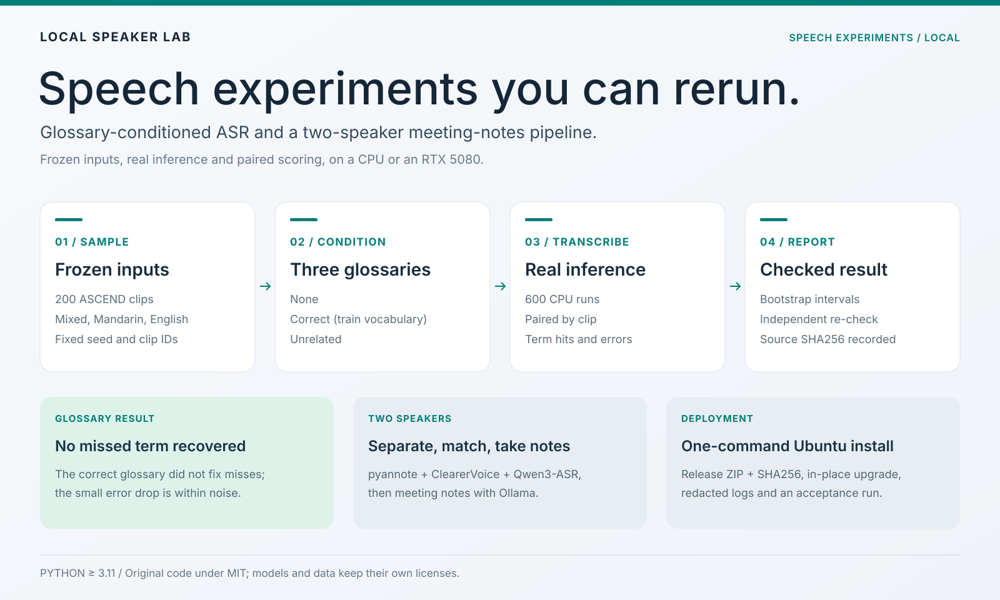

# Local Speaker Lab

[English](README.md) · **简体中文** · [MIT](LICENSE)

**可追溯的语音实验，以及支持插话改期的预约 Agent 原型。**



## 想解决什么问题，打造什么产品

语音系统可能漏掉专名、口头填充词或最新更正，却仍输出流畅文字。本项目让失败可追溯到原音、模型/配置和固定计分规则。

交互主展示是模拟预约助手：边说边听、接受最新时段更正、明确确认后用同一编号改期。离线数据/ASR 支线探索内容保留，避免挑选有利测试集。

## 工作流与方法

| 工作流 | 方法及用途 | 当前阶段 |
|---|---|---|
| [原生预约 Agent](experiments/scheduling/README.zh-CN.md) | PersonaPlex 持续听说、独立业务识别、版本化模拟工具、受控原生播报 | 缓存基线已验证；更快的日期播报候选未采用 |
| [DuplexLab](experiments/duplexlab/README.zh-CN.md) | 音频/来源哈希、审阅、预算匹配筛选、Qwen3-ASR 微调、分组错误与配对区间 | 多轮三 seed pilot 完成；未证明可靠筛选/加权优势 |
| [中英混合词表](experiments/glossary/README.md) | 相同 ASCEND 原音上无/正确/无关词表，词表只来自训练数据 | 200 条×3 组完成；原术语漏识未修复 |
| [双人纪要](docs/TWO_SPEAKER_GUIDE.md) | 分离→人物匹配→识别/对齐→Ollama 纪要 | 已有 Ubuntu 部署路线；与预约、DuplexLab 结论分开 |

顶部图展示已有双人工作流，不代表原生预约模型架构。

## 影响采用决定的结果

| 实验 | 证据 | 决定 |
|---|---|---|
| [原生播报缓存](experiments/scheduling/native-injection/LATENCY_RESULTS.md) | 十次工具更新→网关首有声 PCM 中位 3.338→1.552 秒，减少 53.52%；12 段关键波形核对通过 | 保留缓存原型；真人/回声/听感待验 |
| [预填充候选](experiments/scheduling/native-injection/PREFILL_RESULTS.md) | 中位 0.898 秒，但关键波形仅 11/12 | 不采用；错误日期不能靠低延迟补偿 |
| [日期清晰度后续](experiments/scheduling/date-clarity-2026-10-21/RESULTS.md) | 中位 0.868 秒、20 段核心事实通过，但实际入口有人工确认的错误/含糊日期 | 不采用；解码回放未复现或修复已知失败 |
| [归一化/词元权重](experiments/duplexlab/reports/2026-10-21-normalization/RESULTS.md) | 四臂×42/43/44，各 500 条、63 步；test362/10 个当前拆分 speaker：MER 9.7315/9.8353/9.8353/10.1329% | 未证明总体筛选/加权收益；原生/全1权重、batch1 输入、转写一致 |
| [删除消融](experiments/duplexlab/reports/2026-10-20-deletion/RESULTS.md) | test280 随机/筛选/加权 MER 10.7691/10.3624/10.9632%；同数据加权三 seed 总错误均更多 | 不采用该加权目标；删除与总编辑一起判断 |
| [词表对照](experiments/glossary/ASCEND_200_RESULTS.md) | 600 次真实 CPU 推理，配对核验完成 | 总体错误小幅变化不代表术语漏识已修复 |

预约计时是工具更新→同 epoch 网关首有声 PCM，不含识别、工具等待、浏览器/硬件或严格冷启动。模拟日历固定 2026-10-20；不是原生函数调用或真实日历接入。

DuplexLab 各轮冻结数据不同，不能跨行排名。最新总体对比区间包含零。speaker IDs 在当前拆分隔离，但有项目历史曝光；人工听音待做。batch1 归一化一致性不能外推到混长 batch。

## 如何看实验

[决策索引](docs/EXPERIMENT_INDEX.md)集中列假设、数据集与采用决定。各实验保留计划、汇总、版本、失败候选和复现方法。原音、完整预测、SQLite 状态和权重留本地。

## 开始与验证

核心包 Python ≥3.11；GPU 工作流采用独立 Python 3.12 环境。先读[快速开始](docs/GETTING_STARTED.md)，再选工作流。Windows 由包依赖安装 `tzdata`，提供日历时区。原生 Linux 后端准备另需 GNU `patch`；缺少该命令时，仅对应工具测试跳过。

轻量开发环境：

```bash
python -m pip install --upgrade --only-binary=:all: -r requirements/bootstrap.txt
python -m pip install --build-constraint requirements/bootstrap.txt -r requirements/dev.txt
python -m pip install --no-build-isolation --editable ".[dev]"
python -m pytest -q
```

这里检查合成/替身 CPU 行为，不加载 GPU 模型。[开发](docs/development.md) · [架构](docs/architecture.md) · [部署](DEPLOYMENT.md) · [贡献指南](CONTRIBUTING.md)。

## 下一步

1. 冻结实际入口回归，先诊断预约起句/日期清晰度，再继续提速。
2. 固定 tokenizer 保存/加载 padding 契约，比较混长 batch，再讨论加权。
3. 用 train/dev 核对参考与声学分歧，已观察测试保持已观察身份。
4. 真人麦克风/耳机/AEC 和更广自然表达单独验收。

## 复用与公开范围

原创编排/适配代码采用 MIT；模型、ASCEND 和集成库保留各自许可。[第三方说明](THIRD_PARTY_NOTICES.md)列来源。公开源码不含权重、凭据或原始/生成音视频。[公开范围](PUBLICATION.md) · [工作区](https://github.com/HenryVarro666/voice-ai-workspace)。
