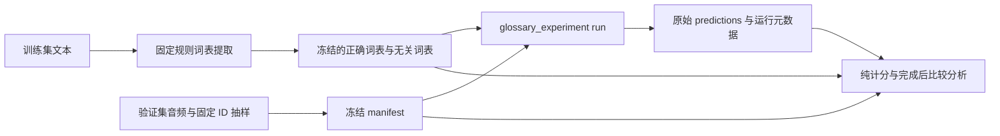
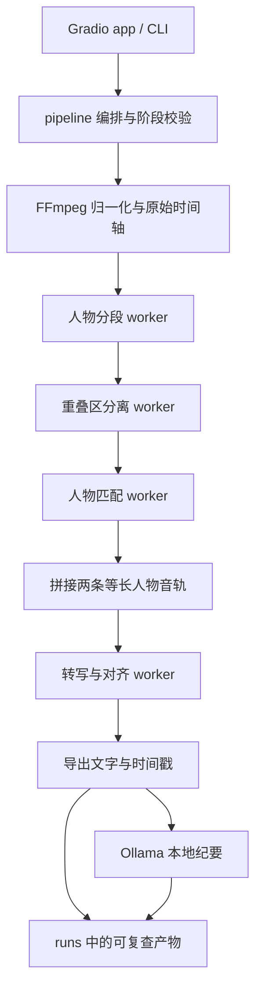

# 架构与边界

Local Speaker Lab 是 the speech project 的本地语音实验代码。两条工作流共用 `src/speaker_lab/` 包；目前的模块、脚本和独立 Python 环境共同构成实现，尚未拆分为多个独立服务或软件包。

## 两条运行路径

### 单人中英混合词表实验

当前主要工作是固定音频与词表的三组配对对照。`speaker_lab.glossary_experiment` 提供 `check`、`run`、`score`：检查输入、执行 Qwen 推理、对保存的原始预测计分。

每条音频均执行 `none`、`personal`、`unrelated` 三个条件；`personal` 是代码中的条件名，在当前训练集派生协议中对应正确词表。词表对整批录音固定。参考转写独立保存，供计分使用；它不进入 Qwen 的上下文。运行记录音频、词表、清单与配置哈希，保留原始模型输出。

`run` 在函数内部才导入 Torch、Qwen 和模型下载工具，直接加载一个 Qwen 模型完成单人实验。它使用固定种子安排音频及条件执行顺序，记录加载、预热和逐次推理耗时。此路径不调用双人分离或强制对齐。

`scripts/analyze_glossary_comparison.py` 在三组配对预测完整后生成新的 `comparison.json`，复核输入哈希和计分，比较参考术语的失误→命中、命中→失误，以及按参考位置锚定的新增/消失错误提及。置信区间使用按语言分层的配对片段 bootstrap；它不估计说话人或会话间相关性。

数据与命令详见[词表实验说明](../experiments/glossary/README.md)，当前可审阅输入见[冻结协议目录](../experiments/glossary/protocols/ascend-val200-train-vocab30-v2)。

### 双人分离、转写与纪要

已有路线面向 Ubuntu 的本地语音处理：`cli.py` 或 Gradio `app.py` 调用 `pipeline.py`，依次进行音频归一化、人物分段、重叠分离、人物匹配、逐人转写与时间对齐，再调用本机 Ollama 生成引用片段 ID 的纪要。

`runner.py` 的 `WorkerRunner` 为各模型阶段启动独立 Python 进程；`worker.py` 加载配置指定的适配器，跨环境交换 JSON 和音频文件。阶段进程结束后释放其模型资源。界面一次执行一个任务，项目没有跨 CLI/界面的全局 GPU 调度器。

图中的分离和匹配只处理检测到的重叠区；单人区间直接归轨。音频协议为 16 kHz 单声道，时间戳使用原录音坐标。每个阶段保留 job ID；分离结果必须完整、唯一地对应请求并返回两个来源，匹配结果必须对应两位不同人物。流水线在启动下一阶段前检查这些边界，避免错误结果继续占用模型资源。

配置决定后端别名、模型及解释器。新增后端实现 `Backend.run(payload, options)`，通过可信的 `module:Class` 配置加载，保持 CLI、界面和流水线入口一致。请求在加载插件前校验；每次运行要求新生成响应，不能复用旧成功文件。分离音频在匹配前检查格式、长度与来源路径，转写和字词时间统一限制到原 job 及父片段范围。纪要客户端独立于语音 worker；纪要失败时仍保留已完成的音轨和转写。具体字段和扩展步骤见[模型接口](model-backends.md)。

完整安装、模型权限、接口、输出文件与真实录音验收见[双人指南](TWO_SPEAKER_GUIDE.md)。

## 核心代码

| 位置 | 职责与依赖边界 |
| --- | --- |
| `src/speaker_lab/glossary_metrics.py` | 标准库实现的确定性归一化、编辑距离、最长完整词条匹配和微平均聚合；不依赖 Torch、NumPy 或模型 |
| `src/speaker_lab/glossary_experiment.py` | 单人实验输入检查、上下文构造、Qwen 运行与重新计分；`check`/`score` 不加载模型，`check` 会读取音频信息 |
| `src/speaker_lab/pipeline.py` | 双人工作流编排、输出导出与阶段间契约检查；使用音频处理依赖 |
| `src/speaker_lab/runner.py`、`worker.py` | 双人模型阶段的进程边界、请求/响应和日志；每阶段可配置不同 Python |
| `src/speaker_lab/backends/` | 延迟加载的 pyannote、ClearVoice、SepFormer、Qwen 适配器；`qwen.py` 为双人路线提供转写和可选真实强制对齐 |
| `src/speaker_lab/audio.py`、`timeline.py` | 音频转换、读写、时间区间与分块支持 |
| `src/speaker_lab/summarize.py` | 本地 Ollama HTTP 纪要、片段引用检查；纪要失败时保留已完成音轨和转写 |
| `src/speaker_lab/config.py`、`redaction.py` | TOML 配置与路径解析、凭证脱敏 |
| `src/speaker_lab/cli.py`、`app.py` | 双人命令行和 Gradio 入口；目前单人实验通过独立模块命令运行 |

计分沿用 `nfkc_han_latin_digits_v1`：NFKC、小写、逐汉字/字母词/数字串分词，使用固定编辑对齐和不重叠的最长完整词条匹配。原始参考与预测使用相同规则，不在分析阶段添加别名、翻译或后验纠错。

## 脚本与配置

| 位置 | 用途 |
| --- | --- |
| `scripts/export_ascend_train_text.py`、`build_ascend_train_glossary.py` | 导出训练集文本并按冻结通用规则提取词表，记录来源、规则、候选计数与哈希 |
| `scripts/prepare_ascend_glossary.py`、`select_glossary_pilot.py` | 数据准备和按语言、时长、固定哈希抽样；抽样不使用参考词汇筛选 |
| `scripts/analyze_glossary_comparison.py` | 完成后的独立比较分析，不修改模型预测或主计分规则 |
| `configs/glossary.toml`、`glossary_cpu.toml` | 单人实验的 GPU/CPU 运行配置；可移植 CPU 配置使用模型标识与固定 revision |
| `configs/glossary_cpu_pilot.toml` | 当前本地试验使用的缓存路径配置；既有运行保留其原配置和哈希 |
| `configs/default.toml` | 双人流程、各阶段 Python、模型、分块、对齐和 Ollama 配置 |
| `scripts/install_ubuntu.sh`、`doctor.py`、`acceptance.py` | 双人路线的环境安装、诊断和真实录音验收 |
| `deploy_ubuntu.sh`、`scripts/deploy_and_accept.py` | 已有 Ubuntu 部署与升级编排 |
| `scripts/package.py` | 既有交付包构建工具 |

## 环境边界

`pyproject.toml` 要求 Python ≥3.11，基础音频依赖为 NumPy、SciPy、SoundFile，界面依赖单列。轻量计分模块本身只需标准库。开发检查可以使用单独环境；真实 Qwen 推理在 ASR 环境运行。

双人 Ubuntu 安装将应用、人物分段/匹配、分离和 ASR 分开安装在 `.venvs/`，可选 SepFormer 使用额外环境。这保留了上游 NumPy、Transformers 和其他依赖的兼容边界。顶层要求在 `requirements/`，Ubuntu/Python 3.12 依赖解析快照在 `requirements/locks/`。锁文件解析和合成测试通过，与目标机器上的完整模型推理验收分别记录。

## 目录与产物边界

| 目录 | 内容 | 维护方式 |
| --- | --- | --- |
| `src/`、`scripts/`、`tests/` | 实现、操作入口和轻量测试 | 按相关工作流修改并验证 |
| `configs/`、`requirements/` | 可审阅的配置与依赖要求 | 新对照使用新配置；保留既有运行的配置哈希 |
| `docs/`、根说明文档 | 开始使用、架构、部署与贡献说明 | 与实际代码入口保持一致 |
| `experiments/glossary/` | 实验说明、可共享协议及本地实验数据目录 | 协议和小型冻结输入可审阅；音频、完整数据副本按本地大产物管理 |
| `runs/` | 原始预测、运行状态、计分与比较分析等结果 | 每次运行使用新目录；完成前的部分预测不作为实验结论 |
| `.cache/`、`.audit-downloads/`、`.venv*/`、`.venvs/` | 模型缓存、下载副本和 Python 环境 | 留在本机，按需复建，不混入代码交付 |
| `dist/` | 本地构建交付包 | 由构建工具生成，不能替代源码和协议 |

本目录上层是 ChatGPT 项目镜像；上层 `sources/` 为只读参考材料。当前整理保留运行路径、冻结输入和现有包布局。将来若拆分模块，需要在独立变更中维护兼容入口并验证两条工作流。
