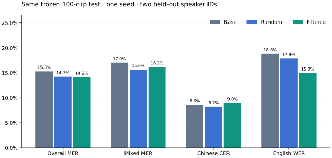
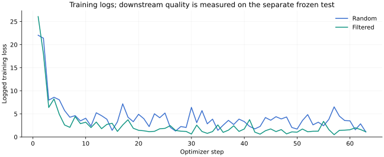

# 新说话人语言验证与 ASR 数据筛选训练

日期：2026-10-20，America/Chicago。状态：新样本语言对照、数据筛选、两组 ASR SFT、真实 checkpoint 重载和固定测试已完成。属于单种子 pilot；人工实际听音与原生流式未验收。

## 结论

新 40 条英文自动语言 WER 为 **20.92%**，指定 English 为 **20.50%**，只少 1 个编辑错误；旧 5 条上较大的变化没有重现。正式 ASR 比较继续使用自动语言。

同一冻结 100 条真人测试，基座 MER **15.31%**，随机 500 条 SFT 为 **14.26%**，参考一致性筛选 500 条 SFT 为 **14.16%**。筛选只比随机少 **1 个错误**，所有主要配对差值区间均跨零，**未获得筛选优于随机的明确证据**。两个微调点估计低于基座，也不足以形成一般改善结论。



## 规则、来源与隔离

[预写协议](../../CONTINUATION_PROTOCOL.md)在新样本输出和训练前确定。使用 ASCEND revision `737e9800ae31be9932ba8464c80366559bd28424` 的首个官方 train 分片，不使用旧 200/725 validation，也不将模型预训练可能见过的公开语料宣称为完全未知数据。[官方语料](https://huggingface.co/datasets/CAiRE/ASCEND/tree/737e9800ae31be9932ba8464c80366559bd28424)。

| 用途 | 官方 speaker ID | 片段数 | 用途边界 |
| --- | --- | ---: | --- |
| 旧开发样本 | 1/2 | 旧 20 | 本轮全部排除这些人 |
| 新英文语言确认 | 13/14 | 40 | 各 20 条；不作正式 SFT test |
| dev | 5/6 | 40 | mixed20 / zh10 / en10；单独导出 |
| 正式 pilot test | 18/24 | 100 | mixed50 / zh25 / en25；训练不读取其误差 |
| 训练候选 | 其他 9 位 | 1,465 | 排除以上人，审计通过且精确去重 |

按 SHA-256(seed, clip_id) 排序选取，seed=20261020，原音解码时长 1–12 秒。角色之间 speaker ID、源 ID、文件/PCM 哈希无重合；保留 session/topic/原文件名，不由 session 数字推断完整对话独立。源参考未被本项目人工纠正。原数据及过滤去向保留在本地审计中。

**旧来源说明更正：** 官方 Parquet 有 original_speaker_id、session_id，初版导入遗漏它们；并非来源没有该字段。旧 20 条来自 speaker 1/2，旧冻结文件和原分数保持原样，后续训练排除了两人。

## 新英文的预写对照

两条件均为 Mac M4 Pro / CPU FP32 / 4 线程 / 同一固定 Qwen3-ASR-0.6B；唯一任务变化为 language 空字符串或 English，aligner 关闭，max_new_tokens=256。

| 条件 | n | S | D | I | N | WER |
| --- | ---: | ---: | ---: | ---: | ---: | ---: |
| 自动语言 | 40 | 28 | 17 | 5 | 239 | 20.9205% |
| 已知 English | 同 40 | 27 | 17 | 5 | 239 | 20.5021% |

1 条编辑数减少、39 条相同、0 条增加。差值 English−auto 为 −0.4184 个百分点，1000 次配对 clip bootstrap 区间 [−1.5306, 0] 个百分点，seed=20261020。仅两位说话人，区间不是说话人聚类或总体推断；English 使用已知标签，不是自动路由策略。[完整配对计数](LANGUAGE_COMPARISON.json)。

## 两组数据选择与训练

两臂均 mixed250/zh125/en125，语言×时长桶配额相同。随机臂用固定 seed 抽样；筛选臂按基座与源参考的 MER、silence_fraction、clip_id 排序。筛选指标是“模型与参考一致”，不是人工确认的标注质量；它会偏向当前基座容易识别的内容。

随机/筛选音频时长分别 **1856.4595 / 1848.0179 秒**，差 0.4547%，低于预定 1%；本次无需时长交换。两臂交集 **229 条**，合计 771 条不同训练录音，不把 1000 次样本使用当作 1000 条独立音频。

固定 Qwen3-ASR-0.6B revision `5eb144179a02acc5e5ba31e748d22b0cf3e303b0`，调用[官方 SFT 入口的固定版本](https://github.com/QwenLM/Qwen3-ASR/tree/7c6daf77a2421100f5fb066495372c00129d39ff/finetuning)。H100 GPU1（CUDA 逻辑卡0），BF16，batch1/grad_acc8、lr2e-5、1epoch、seed42、worker0。实际 checkpoint 的 training_args.bin 已核对这些值，eval batch 为上游默认8。两臂均从同一基座开始，未继承 smoke 权重。

| 阶段 | train/dev | optimizer steps | epoch | 训练子进程耗时 | 实际重载 |
| --- | --- | ---: | ---: | ---: | --- |
| smoke | 8 / 4 | 1 | 1.0 | 27.141s | 是；smoke1 条、正式各100 条转写 |
| random | 500 / 40 | 63 | 1.0 | 86.194s | 是；smoke1 条、正式各100 条转写 |
| filtered | 500 / 40 | 63 | 1.0 | 88.977s | 是；smoke1 条、正式各100 条转写 |

训练日志的 loss、grad_norm、eval_loss 均有限，步骤完整；模型与处理器文件齐全。两个正式 checkpoint 都为 checkpoint-63，包含权重、优化器状态与实际参数；源码、模型、数据和输出哈希见[统计与来源](SUMMARY.json)。以下损失曲线是训练过程记录，不能替代独立测试。



## 冻结测试：总体与语言切片

沿用 glossary_metrics_v1：汉字按字、英文按词，总编辑数/总参考 token 数；不是逐句错误率平均，也不直接对比官方 ASCEND recipe。100 条、N=1045，同一 H100 环境、同一输入、自动语言、aligner 关闭和相同解码上限。

| 模型 | S | D | I | 错误总数 | MER |
| --- | ---: | ---: | ---: | ---: | ---: |
| 基座 | 100 | 38 | 22 | 160 | 15.3110% |
| 随机500 SFT | 106 | 25 | 18 | 149 | 14.2584% |
| 筛选500 SFT | 99 | 30 | 19 | 148 | 14.1627% |

| 切片 | 片段数 / N | 基座 | 随机500 | 筛选500 |
| --- | --- | ---: | ---: | ---: |
| mixed MER | 50 / 582 | 17.0103% | 15.6357% | 16.1512% |
| 中文 CER | 25 / 256 | 8.5938% | 8.2031% | 8.9844% |
| 英文 WER | 25 / 207 | 18.8406% | 17.8744% | 14.9758% |

筛选相对随机：英文少6个错误，中文多2个、中英混合多3个，整体只少1个。不能只展示英文的有利切片，也不能由低训练损失推断下游普遍收益。

| 配对差值（候选−基线） | 点估计，百分点 | clip bootstrap 95% 区间，百分点 | 片段改善/退化/相同编辑数 |
| --- | ---: | --- | --- |
| 随机−基座 | -1.0526 | [-3.1153, +0.9191] | 19/16/65 |
| 筛选−基座 | -1.1483 | [-2.8956, +0.4990] | 14/11/75 |
| 筛选−随机 | -0.0957 | [-2.0391, +2.0115] | 18/13/69 |

1000 次配对重采样、seed=20261020。区间单位是片段，并非说话人聚类；正式 test 仅两个 speaker ID，训练仅一个 seed。主要差值区间均跨零，本轮只交付可复现的点估计和零/负证据，不给一般化改善结论。

## 计时、资源与复算

ASR 训练池整批模型子进程 301.270s；test 的 base/random/filtered 整批分别 26.384/24.882/23.163s。ASR 起点为调用 WorkerRunner 前、终点为整批最终结果返回，含进程/加载/推理，不含前置审计、后续计分和 SQLite 归档。训练耗时从启动 trainer 子进程至返回，含加载、训练、dev loss 评估及保存。它们不是逐句文本延迟、严格冷启动、TTS 首块或完整说完到首声，也不据这三次整批差异宣布推理提速。

2×H100 NVL 各95,830MiB，物理GPU1用于本实验；GPU0已有Avatar任务，未停止。2秒采样期间GPU1最高9,623MiB，监测开始晚于smoke；这是采样值，非完整allocator峰值或部署显存保证。模型/环境/数据/checkpoint在独立数据盘目录，root磁盘不放这些大文件。未访问apex。

Python3.12.11、Torch2.8.0、Transformers4.57.6、qwen-asr0.0.6、datasets4.8.3、accelerate1.12.0；实际版本/参数在统计JSON。原始数据、SQLite、源码副本、模型和完整预测均留私有data/runs/checkpoints，公开仅计数、ID、哈希及汇总图。训练源码副本保留实际运行版本；后续人工审阅导出边界修复未用于本次全部source_reference的训练，不冒称重训。

已在Mac使用本地原音、冻结协议、原始SQLite预测重新计分，并重算全部配对区间，与H100结果完全一致；没有再次加载模型。工程、浏览器及来源检查见[验证记录](VALIDATION.md)。

## 复现与产物

准备脚本为 scripts/prepare_duplexlab_pilot.py；计算入口为 scripts/run_duplexlab_continuation.py 的 pool/train/evaluate 三阶段。先设置独立环境、固定本地模型和新输出目录；已有输出会拒绝覆盖。下例是阶段模板，完整参数、版本和源文件哈希以本次记录为准：

```bash
PYTHONPATH=src /path/to/gpu-venv/bin/python scripts/run_duplexlab_continuation.py --root . --model /path/to/pinned/snapshot --phase pool
PYTHONPATH=src /path/to/gpu-venv/bin/python scripts/run_duplexlab_continuation.py --root . --model /path/to/pinned/snapshot --phase train
PYTHONPATH=src /path/to/gpu-venv/bin/python scripts/run_duplexlab_continuation.py --root . --model /path/to/pinned/snapshot --phase evaluate
```

图和三模型本地回放可用 scripts/report_duplexlab_continuation.py 从归档重建；回放为 runs/duplexlab/h100-continuation-v1/replay/comparison.html，按筛选−随机的编辑数差异查看全部/改善/退化案例，未标为人工已审。两组真实模型在H100独立实验目录的 checkpoints/duplexlab/random/checkpoint-63 和 filtered/checkpoint-63，未上传GitHub。

下一步优先人工回听分歧、扩大独立说话人并复验训练seed；使用过的测试历史继续保留。流式与原生全双工模型训练另行验收。本轮没有部署、提交、推送或启动子代理。
