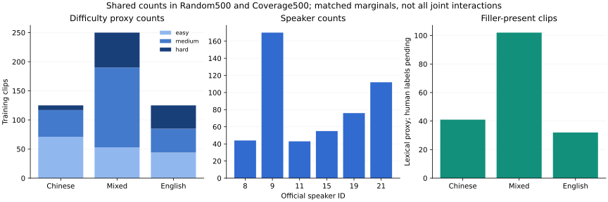
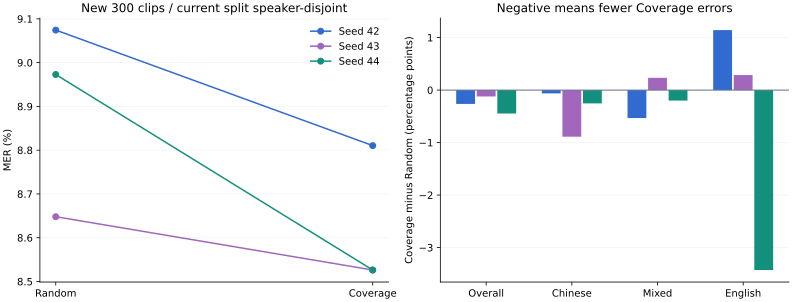

# 覆盖约束筛选、三训练 seed 与新测试

2026-10-20，America/Chicago。六次从同一基座开始的 SFT、dev 重载和新 test300 均已完成。**覆盖筛选在三个 seed 的整体点估计均优于随机，平均 MER 8.8984% → 8.6209%，差 −0.2774 个百分点；探索性区间 [−0.5559, 0.0000] 仍包含零，尚未建立可靠优势。含填充词组平均略退化。** 本轮没有继续调规则或挑最好 seed。

## 训练前设计与隔离范围

[冻结协议](../../COVERAGE_PROTOCOL.md) · [设计与约束](DESIGN.md) · [完整聚合 JSON](SUMMARY.json) · [覆盖审计](COVERAGE_AUDIT.json) · [验证](VALIDATION.md) · [复现](REPRODUCE.md)。

当前 train1015 来自 speaker8/9/11/15/19/21；dev40 为5/6；新 test300 为10/16/26，每人 mixed50、zh35、en15。三角色说话人、片段 ID、文件和 PCM 哈希不重合，全部音频 audit pass。新 test 来自其余官方 train 分片，与本支线此前的训练、开发、确认与测试片段零重合；选取在新预测前按固定哈希排序完成。

**独立性限定于当前六次训练。** 三位测试说话人曾在旧训练池；历史词表提取也读过完整官方 train 文本。六模型因此全部重新从原始基座训练，不复用旧 SFT checkpoint 或词表。不能声称整个项目从未见过这些人、完整会话独立、外部语料验证或已排除预训练曝光。其他 ASCEND 可用说话人已进入历史协议，未用更强措辞掩盖这一限制。

Random500 按语言×时长分层随机；Coverage500 在不接触新测试输出的情况下，最小化训练池基座与源参考的逐段 MER 之和，同时精确匹配 Random 的四组边际：语言×时长、语言×说话人、语言×难度、语言×填充词。两臂 mixed250/zh125/en125，交集317、并集683。难度是基座与源参考不一致程度的代理；填充词是词面有无的代理，均不是人工声学标签。仅匹配边际，不保证所有联合分布、桶内难度或填充词频次相同。

中文每臂保留54条非零难度、41条含填充词；mixed 保留60条 hard、102条含填充词。避免了上轮纯一致性筛选中文125条全 easy 的结构。MILP 报告 optimal、gap7.8e−9、无 fallback；选择目标71.1150 → 53.1299只表示训练样本参考一致性提高，不能当作人工质量或测试效果。

## 相同预算与先 dev 后 test

两臂各500条、1epoch、batch1、gradient accumulation8、学习率2e−5、BF16、63个 optimizer steps；seed42/43/44均使用同一显式 seed 适配器。六份实际训练参数除 seed 外一致，实际 trainer state 和重载权重哈希已验证。随机/覆盖音频1965.409/1984.1537秒，差0.9537%，符合预写≤1%预算；参考归一化 token7591/7863，**没有严格匹配模型 BPE token 或 FLOP**。

dev40保持原集合，不为了改善诊断结果重抽。每种语言均覆盖 easy/medium/hard 与填充词有/无，speaker5/6隔离于训练；[train/dev 诊断表](TRAIN_DEV_FEATURES.json)在新测试输出前冻结。先完成六个 dev 重载，再写入 DEV_COMPLETE 标记，最后运行新 test。没有利用 dev 挑多个筛选候选、最好 seed 或额外训练轮次。

dev 的固定参考 N=319：基座46错，14.4201%。

| seed | Random 错误 / MER | Coverage 错误 / MER |
|---|---:|---:|
| 42 | 46 / 14.4201% | 44 / 13.7931% |
| 43 | 46 / 14.4201% | 46 / 14.4201% |
| 44 | 47 / 14.7335% | 45 / 14.1066% |
| 均值 | 14.5246% | 14.1066% |

dev 差 −0.4180pp，区间 [−2.2039,+0.8418]pp。三次重复共少4错，平均每 seed 少1.333错；仍是40条唯一录音，不是120条独立开发样本。

## 新 test300 主结果

自动语言、BF16、SDPA、max_new_tokens256、关闭 aligner；固定源参考和既有中文字符/英文词混合计分，N=4926。基座 S/D/I=263/108/100，共471错，MER9.5615%。现有机器可读键 `filtered` 在本轮专指 Coverage，不能混同上一轮的纯一致性筛选。

| seed | Random S/D/I | Random MER | Coverage S/D/I | Coverage MER | Coverage−Random |
|---|---|---:|---|---:|---:|
| 42 | 267/74/106 | 9.0743% | 254/84/96 | 8.8104% | −13错 / −0.2639pp |
| 43 | 253/88/85 | 8.6480% | 249/92/79 | 8.5262% | −6错 / −0.1218pp |
| 44 | 266/93/83 | 8.9728% | 244/90/86 | 8.5262% | −22错 / −0.4466pp |
| 均值 | — | **8.8984%** | — | **8.6209%** | **−0.2774pp** |

差值 SD0.1628pp、范围[−0.4466,−0.1218]pp；相对错误率下降3.12%，仅为该固定测试的描述。三个重复共少41错，平均每 seed 少13.667错；**唯一测试样本仍为300条、3人**。seed 方差不代表抽取不同训练集合的方差，两臂选择集合固定。

5000次配对交叉 bootstrap 同时重采样训练 seed 和整个说话人，保留被抽说话人的全部片段，bootstrap seed20261020。Coverage−Random 的探索性95%区间为 **[−0.5558987,0.0000000]pp**，上界恰触零，不能写成严格排除零。说话人宏平均差 −0.2776pp。只有3训练 seed、3测试说话人，不能据此声称总体显著优胜。

## 中文、混合、填充词与删除错误

以下为同一测试上三训练 seed 的平均 MER，分组均为描述性；没有为各组宣称显著性。

| 组 | 唯一条数 / N | Random | Coverage | 差值 pp |
|---|---:|---:|---:|---:|
| 中文 | 105 / 1576 | 5.9645% | 5.5626% | −0.4019 |
| 中英混合 | 150 / 3000 | 9.9222% | 9.7556% | −0.1667 |
| 英文 | 45 / 350 | 13.3333% | 12.6667% | −0.6667 |
| 填充词代理：有 | 91 / 1838 | 10.4099% | 10.5731% | **+0.1632** |
| 填充词代理：无 | 209 / 3088 | 7.9987% | 7.4590% | −0.5397 |

中文在3个 seed 都少错；mixed 在seed43多7错，另外两次少16/6错；英文在42/43多4/1错、44少12错。三个说话人均为平均改善，但speaker10的seed43多6错、speaker26的seed42多1错，不能把整体方向当成每个子组均改善。

三次重复的 S/D/I 总和：Random786/255/274，Coverage747/266/261。替换少39、插入少13，**删除多11**；这也不能直接等同于已听出吞词。填充词组错误差依次+1/−3/+11，两个 seed 更差。数量覆盖约束已满足，但并未证明模型保留口语现象的能力得到改善。

严格计分下8条在三个 seed 都更差，私有清单保留源文和全部预测。优先检查：05012（mixed，含填充词，三次各+4错，`U S T C`/`USTC`词形差异参与计分）；08768（mixed，+4/+3/+2，英文专名变中文）；08581（mixed，含填充词，+2/+1/+2，尾部填充词和字母分词差异）；03450（mixed，+2/+2/+1，源参考含UNK）。这些是转写/参考对照线索，**未人工回听，不改参考、不回扣错误，也不把严格分词差异直接称作声学退化**。

## 证据、计时与下一步

本地私有回放：`runs/duplexlab/coverage-v1/replay/test.html`（test300）和 `dev.html`（dev40）。可按seed、编辑数增减、语言、填充词筛选，含全部340张卡和原音频；人工听音均pending。完整逐段文本、音频、SQLite和训练权重不进入公开报告/源码包。

六次训练子进程71.983–77.282秒：从启动训练子进程，到模型加载、训练、dev loss和保存全部完成；不包含随后权重哈希和ASR评估。新test每批300条：基座67.867秒、六checkpoint59.576–64.121秒；起点为WorkerRunner调用前，终点为调用返回，包含子进程模型加载与完整转写，排除后续计分/SQLite归档。dev批次保留12.601–40.616秒全部记录，慢批次未删除。这些是离线已录音频批处理时长，不是识别首字、TTS首块、完整说完到首声、严格冷启动或独占GPU速度结论。

已经独立复算14个完整ASR批次、2380次推理；唯一新测试300条、dev复用40条。训练池基座预测复用旧已验证结果，没有重复推理或训练。全部1355份源WAV、manifest/导出/执行源码/六个实际重载模型绑定一致。资源最近核验2026-10-20：只使用H100物理GPU1，完成后14MiB/0%，现有GPU0工作保留；未访问apex、部署、提交或推送。

本轮支持“在相同500条/63步及≤1%音频预算下，覆盖筛选整体点估计改善，但可靠优势未确立，填充词保留仍是弱点”。不能直接横比上轮10.90%与本轮8.62%来证明约束收益，两轮训练池和测试不同，且本轮没有同拆分纯筛选第三臂。后续先人工核对上述参考/专名/填充词案例；再建立填充词频次、重复和代码切换跨度等train/dev标签，在另一个预先冻结、说话人/会话来源可核验的测试上验证。当前test300已观察，不再作为后续调参的未见测试。
