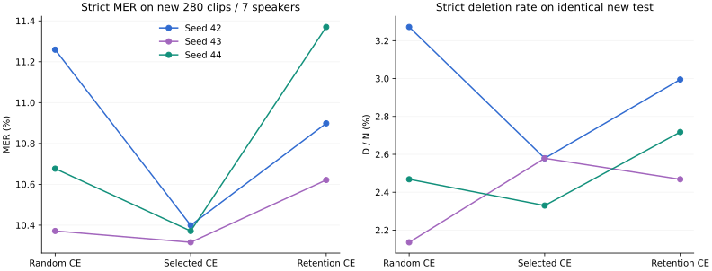
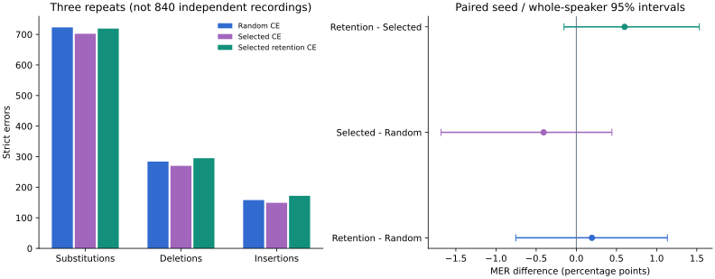

# 删除保留：三臂、三seed与新280条测试

2026-10-20 America/Chicago。已完成最终九次基座新训，每次500条、63 optimizer steps、epoch1，全部实际重载。联合候选相较随机的区间包含零，尚未建立可靠总体优势。 加权目标相较同筛选原CE在三个seed的总编辑均更多，平均MER高0.6009pp；本轮不支持采用该加权目标。筛选原CE三seed整体均少错，但相较随机的区间仍跨零，填充词token删除25→35。三次总删除为 **284 / 270 / 295**。主参考与严格归一化未改，人工听音pending。

## 新测试结果

新280条录音、7个当前train/dev/test隔离的speaker IDs；每人zh20/mixed10/en10。7位有项目历史曝光，不称项目从未见过的说话人。N=3606；三次重复不是840个独立录音。

| Seed | 随机＋原CE：MER / D / 总编辑 | 筛选＋原CE：MER / D / 总编辑 | 同筛选＋保留CE：MER / D / 总编辑 |
|---|---|---|---|
| 42 | 11.2590% / 118 / 406 | 10.3993% / 93 / 375 | 10.8985% / 108 / 393 |
| 43 | 10.3716% / 77 / 374 | 10.3161% / 93 / 372 | 10.6212% / 89 / 383 |
| 44 | 10.6767% / 89 / 385 | 10.3716% / 84 / 374 | 11.3699% / 98 / 410 |
| 平均MER | 10.7691% | 10.3624% | 10.9632% |

| 对照（右−左） | MER差 / pp | 95%配对seed/整说话人区间 / pp | D/N差 / pp | D/N区间 / pp |
|---|---:|---|---:|---|
| 保留CE−随机 | +0.1941 | [-0.7538,+1.1337] | +0.1017 | [-0.5120,+0.9826] |
| 筛选原CE−随机 | -0.4067 | [-1.6838,+0.4431] | -0.1294 | [-1.1726,+0.5565] |
| 保留CE−同筛选原CE | +0.6009 | [-0.1532,+1.5320] | +0.2311 | [-0.2600,+1.1696] |

5000次、seed20261020，按训练seed和整说话人交叉重抽样；三个对照均探索性、未做多重比较校正。固定selection seed不衡量数据选择方差。每seed配对信息、样本SD/范围/speaker-macro见[SUMMARY.json](SUMMARY.json)。目标对照包含自定义归一化/梯度累积路径及2×词权重，不能只归因于乘数本身。

## 删除与语言分组

| 三次累计 | S | D | I | 填充词token删除 | 单ASCII字母删除 | 其他token删除 |
|---|---:|---:|---:|---:|---:|---:|
| 随机＋原CE | 723 | 284 | 158 | 25 | 21 | 238 |
| 筛选＋原CE | 702 | 270 | 149 | 35 | 27 | 208 |
| 同筛选＋保留CE | 719 | 295 | 172 | 29 | 25 | 241 |

| 组别 | 录音数 | 随机平均MER | 筛选平均MER | 保留平均MER | 三次D：随机/筛选/保留 |
|---|---:|---:|---:|---:|---|
| language / zh | 140 | 6.3633% | 6.0501% | 6.0831% | 97 / 99 / 92 |
| language / mixed | 70 | 16.0197% | 15.1571% | 17.1596% | 140 / 119 / 155 |
| language / en | 70 | 17.1979% | 17.3971% | 17.2643% | 47 / 52 / 48 |
| filler_present | 68 | 13.1206% | 13.0239% | 13.1206% | 81 / 96 / 88 |
| repetition / 1 | 39 | 12.6474% | 11.7363% | 13.3976% | 76 / 69 / 80 |
| repetition / 2+ | 11 | 16.5485% | 16.0757% | 15.3664% | 29 / 29 / 30 |
| frequency / 2+ | 10 | 16.1972% | 15.0235% | 14.0845% | 22 / 26 / 19 |
| source_unk | 8 | 24.2894% | 24.5478% | 26.3566% | 3 / 7 / 3 |

新筛选总D减少14，由其他token减少30、填充词增加10及单ASCII增加6共同形成；保留CE相较同筛选总D增加25，来自其他token增加33，而填充词减少6、单ASCII减少2。中英混合MER在同数据加权后15.1571%→17.1596%，不能把局部填充词/重复改善当总体修复。新test含68条填充词、50条重复；频次≥2仅10条，重复≥2仅11条。D降低若同时变成S或I不代表内容保留已修复。分组可能有重叠，不能相加为总样本。词面填充/重复/切换均是代理，删除位置在重复词或跨语词形中存在对齐歧义。三seed稳定删除位置数为随机58/筛选60/加权57，少稳定位置并不等于少总删除。加权相较同筛选有5条/6个额外稳定位置（就×2、华、了、里、early），其中4个位置有最优对齐歧义；两个强制位置了/里并未增加各条D总量，存在位置/错误类型转移，不能称新声学漏词。详见SUMMARY的new_stable_extra。新稳定删除位置总数见SUMMARY，逐参考位置和全部原音/三个seed转写留私有回放。

## 旧退化核对与训练干预

旧disfluency-v1的1920个对齐全量复算：三次D296→318。候选有11个额外三seed稳定位置；仅5个在所有最优对齐下都强制删除，且这5个没有随机组三seed均为精确匹配的干净反例。“很”重复次数减少是最清晰的文本级保留退化，但删除哪一份重复仍模糊；“了”是替代转删除且总体少错；alphago拆词敏感性仍有其他分歧。见[完整11例](REGRESSION_ANALYSIS.md)。没有据此修改新test参考或设置专用词白名单。

训练池1015保持；Random500沿用原ID，筛选新增基座D频次/尾部D/UNK边际，保持全部既有覆盖，音频1965.409 / 1984.75575s，差0.9844%。选择目标sum((S+I+0.5D)/N)，MILP最优无fallback。保留组与筛选原CE的ID/音频/参考完全相同。源参考token7591/7827/7827，不声称精确BPE/FLOP一致。

保留loss只使用train基座所有最优对齐下的删除与邻接重复代理；164条中471个源token跨度对应369个加权子词，2×，源UNK/数字/单ASCII字母/全大写ASCII词不额外加权。原监督文本保留；每次500训练+52dev，共552个实际suffix检查全部通过。模型内token可能同时覆盖邻字。细节见[设计](DESIGN.md)及[原协议](../../DELETION_PROTOCOL.md)。

## 开发集、故障与运行证据

开发集预先固定为已知primary40＋challenge12=52，同speaker5/6；本轮统一用作eval_file。它们均已观察，不作独立测试。九组先完成dev ASR重载、写DEV_COMPLETE，再开始新test；没有按dev/test选择seed、checkpoint或改目标。

| Dev面板 | 随机平均MER | 筛选平均MER | 保留平均MER |
|---|---:|---:|---:|
| overall | 12.4909% | 11.6195% | 12.4909% |
| dev_panel / primary40 | 14.5246% | 13.5841% | 14.1066% |
| dev_panel / challenge12 | 7.8571% | 7.1429% | 8.8095% |

初次预检在音频未传完时拒绝，未加载模型。Attempt0两个原CE组完成63步后，保留组在step50的dev标签guard拒绝；复现原上游batch8对首8条dev有7条前缀/audio token泄漏。全部归档排除，冻结[评估补充协议](../../DELETION_EVAL_ADDENDUM.md)，三臂统一eval batch1后九次全部从基座重跑，未沿用失败权重。总计12次SFT尝试：最终9完整＋排除2完整＋1partial；最终比较每组预算仍500/63。历史离线ASR分数不改，历史batched eval_loss不能当纯参考损失。

最终九次trainer子进程耗时74.098–81.463s，起点为启动trainer进程、终点为进程退出，包含模型加载、训练、52条dev损失与保存，不含后续权重哈希/ASR。最终20批ASR含加载及整批转写，WorkerRunner调用→返回为14.649–60.285s，不含外部GPU排队、审计/计分/SQLite归档；不是首字/首声、真人输入或严格冷启动延迟，共3320次录音推理。共享H100环境，非独占吞吐benchmark。

1347源音频/PCM/标签、最终9权重及实际18参数、63步trainer状态、20批原SQLite计分与所有MER/D bootstrap均独立复算。完整验证、环境及源码包检查见[VALIDATION.md](VALIDATION.md)，操作见[REPRODUCE.md](REPRODUCE.md)。只操作独立H100目录/物理GPU1，外部GPU任务自然等待；未访问apex、启动子代理、提交、推送或部署。

## 下一步

先回听稳定重复/句尾/跨语边界反例并保留版本化参考审阅，再决定新的预写实验。当前280已经观察，不能继续调参后当未见测试。后续应分离自定义归一化与2×权重的贡献，并考虑分层数据选择seed方差及更广的外部语料；本轮不追加训练或挑有利子组。
