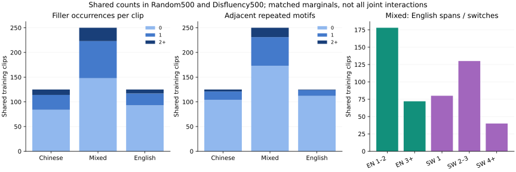
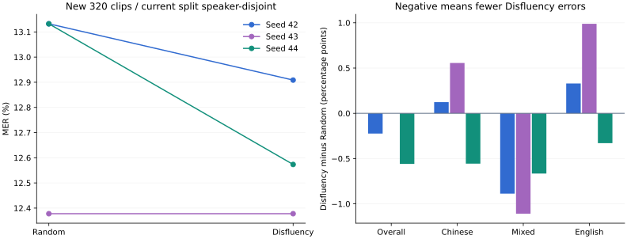

# 填充词频次、重复与切换跨度约束实验

2026-10-20，America/Chicago。六组基座新训、全部主测试与dev挑战诊断完成。新test320上Random/Disfluency平均MER **12.8807% / 12.6199%**，差 **-0.2608pp**，配对seed/说话人探索性区间 **[-0.9295, +0.2436]pp**；**区间包含零，尚未建立可靠优势**。含填充词64条平均19.6048%→18.8248%；删除与罕见组须同时查看，不能只凭总体分数称问题解决。

[预写主协议](../../DISFLUENCY_PROTOCOL.md) · [dev补充协议](../../DISFLUENCY_DEV_ADDENDUM.md) · [旧8案例复核](REGRESSION_ANALYSIS.md) · [选择设计](DESIGN.md) · [完整聚合](SUMMARY.json) · [分组计数](DISFLUENCY_GROUPS.json) · [验证](VALIDATION.md) · [复现](REPRODUCE.md)。

## 先分析，再冻结一个候选

上轮总D255→266，填充词D20→29、单字母7→17、其他228→220；全部1800条最小编辑对齐与原S/D/I/N一致。八条稳定退化逐一列出，05012严格缩写分词影响很大，08581仅42/44漏尾嗯，43不属于填充词删除。USTC诊断不替换原分；原参考、UNK、拼写与主归一化都保留，未冒称人工听音。

当前train1015（speaker8/9/11/15/19/21）、训练dev40（5/6）沿用；新test320（13/14/18/24）每人mixed25/zh35/en20，全部audit pass，新片段/文件/PCM与本支线所有旧manifest无重合，当前三角色说话人隔离。**测试ID有旧确认/测试曝光，历史glossary看过所有官方train文本**；六模型全部从同基座新训，不用旧SFT/词表，不声称整个项目首次见这些人、会话完全独立、外部语料泛化或已排除预训练曝光。

Random保持同一500条集合和selection seed20261021；本轮仍重新训练三个Random模型。新策略在旧语言×时长/说话人/难度/填充词有无边际之外，匹配每语言填充词频次桶与总次数、重复桶与总额外拷贝、切换次数和英汉最长跨度桶。英文按词、中文按字，UNK/数字阻断；重复检测为相邻1–4 token短语，最长覆盖/同长最短单元、不重叠。全部为词面代理，不是时间跨度、人工情绪或真实犹豫标签。

两臂各mixed250/zh125/en125，填充词总次数234、重复额外拷贝148均完全匹配；MILP报告optimal，无fallback，目标逐段MER之和71.1150→54.2301。音频1965.409/1984.361秒，差0.9643%，交集319/并集681。只匹配边际及指定总数，不匹配全部交互/桶内复杂度。参考token 7591/7851，**非严格BPE token/FLOP相同**。两臂500条、1epoch、63steps、batch1/gradacc8/lr2e−5/BF16，实际18参数除seed一致，六个真实dev/test重载模型及原始trainer state均验证。

## 主test320结果

原基座S/D/I=294/117/63，474/3579=13.2439%。所有模型自动语言、BF16/SDPA/max256/aligner关闭；中文字符/英文词严格计分不合并别名、不翻译等价。机器可读filtered键本轮专指Disfluency。

| seed | Random S/D/I | Random MER | Disfluency S/D/I | Disfluency MER | 新策略−随机 |
|---|---|---:|---|---:|---:|
| 42 | 309/93/68 | 13.1322% | 298/107/57 | 12.9086% | -8错 / -0.2235pp |
| 43 | 280/100/63 | 12.3778% | 282/98/63 | 12.3778% | +0错 / +0.0000pp |
| 44 | 300/103/67 | 13.1322% | 279/113/58 | 12.5733% | -20错 / -0.5588pp |
| 平均 | — | **12.8807%** | — | **12.6199%** | **-0.2608pp** |

差值样本SD0.2813pp，范围[-0.5588,+0.0000]pp；speaker宏平均差-0.3504pp。5000次配对交叉bootstrap重采样训练seed和整位speaker，保留其所有片段，bootstrap seed20261020；区间[-0.9295, +0.2436]pp。**仍只有320条唯一录音、4位speaker**，不是960条独立样本。仅3训练seed，未测选择seed方差，会话簇独立未知，区间仅探索性。

| 语言 | Random均值 | Disfluency均值 | 差 |
|---|---:|---:|---:|
| 中文 | 9.7179% | 9.7591% | +0.0412pp |
| 中英混合 | 15.5457% | 14.6588% | -0.8869pp |
| 英文 | 15.3762% | 15.7057% | +0.3295pp |

## 填充词与删除

三次重复合计S/D/I：Random 889/296/198，Disfluency 859/318/178；总D差+22。填充词token删除26→25，差-1。单ASCII字母删除27→27，其他token删除243→266；单字母包含I/a等实词，不全是缩写。该分解使用与主计分相同的确定性对齐，重复文本有对齐歧义，**不是人工听出的吞词率**。词面填充词组64条，平均MER19.6048%→18.8248%。

以下为三个训练seed的分组平均；同组仍是同一批唯一片段，稀有组不宣称显著性。

| 词面组 | 唯一条数 | Random MER | Disfluency MER | 差 |
|---|---:|---:|---:|---:|
| frequency / 0 | 256 | 11.4137% | 11.2662% | -0.1475pp |
| frequency / 1 | 59 | 20.6239% | 19.9307% | -0.6932pp |
| frequency / 2+ | 5 | 10.4167% | 8.8542% | -1.5625pp |
| repetition / 0 | 293 | 12.3558% | 12.1040% | -0.2517pp |
| repetition / 1 | 23 | 14.7330% | 14.8250% | +0.0921pp |
| repetition / 2+ | 4 | 38.4615% | 34.1880% | -4.2735pp |
| switches / 0 | 221 | 11.3680% | 11.4569% | +0.0889pp |
| switches / 1 | 63 | 17.1362% | 16.2911% | -0.8451pp |
| switches / 2-3 | 29 | 13.5480% | 12.8773% | -0.6707pp |
| switches / 4+ | 7 | 13.2791% | 11.6531% | -1.6260pp |
| en_span / 0 | 140 | 9.7179% | 9.7591% | +0.0412pp |
| en_span / 1-2 | 51 | 12.8310% | 12.2878% | -0.5431pp |
| en_span / 3+ | 129 | 16.3830% | 15.8838% | -0.4992pp |

主测试仅5条多填充词、4条多次重复；这些组的点估计不能推广为已解决复杂口语。匹配训练频次/跨度不保证学会保留所有词，也不修复源参考错误。

## Dev40与补充挑战12分列

主训练eval_file保持原dev40，固定N319。全部六模型先dev重载、写DEV_COMPLETE，再一次性主新test；不按dev选最好seed/checkpoint。

| seed | Random 错误 / MER | Disfluency 错误 / MER |
|---|---:|---:|
| 42 | 46 / 14.4201% | 42 / 13.1661% |
| 43 | 46 / 14.4201% | 37 / 11.5987% |
| 44 | 47 / 14.7335% | 42 / 13.1661% |

原dev40平均14.5246%/12.6437%，差-1.8809pp，区间[-4.1322, -0.3367]pp；仅两位已使用dev speaker，不能当新测试证据。

发现dev40没有重复≥2后，明确另立补充协议：从313个未用、同speaker5/6的audit pass候选，按纯文本覆盖和固定哈希排序MILP选12条，speaker7/5，zh4/en2/mixed6，四类hard覆盖至少2且实际各2。选择不使用任何预测错误；冻结在新test-base不存在时绑定12音频/manifest/policy/addendum/时间。**补充选择晚于主训练启动及初始dev观察，数据冻结早于主新测试，七模型诊断在主流程后串行运行**；没有改写最初主协议或谎称全部dev从一开始完整覆盖。主训练eval_file、六模型和策略未变。

| seed | 挑战Random错误 / MER | 挑战Disfluency错误 / MER |
|---|---:|---:|
| 42 | 14 / 10.0000% | 10 / 7.1429% |
| 43 | 8 / 5.7143% | 8 / 5.7143% |
| 44 | 11 / 7.8571% | 10 / 7.1429% |

挑战12平均7.8571%/6.6667%，差-1.1905pp，区间[-3.6364, +0.0000]pp。它是定向难例集，只有12条/2人，不代表自然分布；与原40合计52条但仍只有两个dev簇，不混成主测试或当新说话人。分组与完整[挑战结果](AUXDEV_RESULTS.json)保留。

## 复算、回放、计时与后续

21完整ASR批次/2604次片段推理：主14批/2520，挑战7批/84。新test320、新dev12、原dev40复用；所有1387源WAV/角色/ID/文件/PCM/导出/执行源码/六个实际重载权重已校验，主dev/test及挑战bootstrap独立重算一致，无模型重推。

本地私有回放位于runs/duplexlab/disfluency-v1/replay/的test.html（320）、dev.html（40）、auxdev.html（12）；含所有seed/增减/语言/填充词筛选和词面特征，音频、全文、SQLite、模型权重不入公开包。浏览器结构/音频加载检查不等于人工听音，人工仍pending。

训练子进程73.685–88.746秒，从子进程启动到加载/训练/dev loss/保存退出，不含后续权重哈希和ASR。主test320每批54.976–63.161秒，从WorkerRunner调用前到返回，含加载/全部转写，排除审计、后续计分和SQLite归档。GPU1起初被外部任务占用，等待其自行释放后启动；保留全部时长，**不是独占GPU速度、首字、TTS首块、完整说完到首声或严格冷启动**。

这轮没有同新test的旧Coverage第三臂，不能横比旧8.6209%和本轮结果来声称新增约束的因果收益。当前320已观察；下一轮先在train/dev核对真实口语标签、参考/专名与UNK，再冻结另一来源/会话可核验测试，不能继续用当前测试挑规则。原参考/原分和负结果全部保留。最新环境/测试/源码包边界见VALIDATION；未访问apex、部署、子代理、提交或推送。
