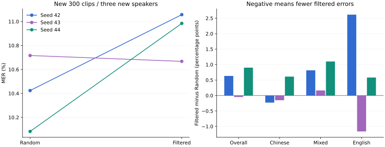
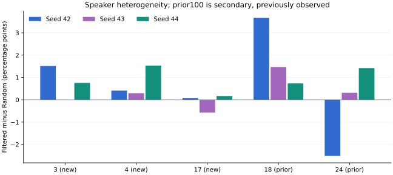

# 三seed与新说话人：参考一致性筛选没有表现出可靠优势

2026-10-20。已完成旧退化分析、新300条/3位此前未进入本实验的说话人，以及random/filtered各42、43、44三个训练seed。seed42复用已完成checkpoint；新训练4组，全部63步且真实重载。旧100条/2人单列为次要分析，合并覆盖400条/5个官方speaker ID。

**主结果：随机平均MER10.4075%，筛选10.9027%，筛选−随机=+0.4952个百分点，跨seed样本SD0.4897，范围[-0.0487,+0.9011]。5000次配对交叉seed/说话人bootstrap区间[-0.1378,+1.1198]个百分点，包含零。** 当前固定筛选集合没有可靠优势；均值较差也不足以证明一般人群上的劣势。不能继续沿用旧seed42/test100“少1错”描述为筛选收益。

## 主测试：300条，N=4106，只计一次

| seed | Random S/D/I | Random MER | Filtered S/D/I | Filtered MER | 筛选多错数 | 筛选−随机，pp |
|---|---|---:|---|---:|---:|---:|
| 42 | 252/91/85 | 10.4238% | 276/93/85 | 11.0570% | +26 | +0.6332 |
| 43 | 267/87/86 | 10.7160% | 260/95/83 | 10.6673% | -2 | -0.0487 |
| 44 | 246/89/79 | 10.0828% | 266/87/98 | 10.9839% | +37 | +0.9011 |

基座单次同条件为S275/D105/I103，483/4106=11.7633%。两个训练臂的平均点估计低于基座，但本轮区间针对筛选−随机，不将基座差异当作已建立的总体提升。三个seed共用同300条，不把N重复累加成12318个独立参考token。

| 新测试语言 | clips / N | 随机三seed均值 | 筛选三seed均值 | 差值，pp |
|---|---:|---:|---:|---:|
| zh | 105 / 1309 | 7.3848% | 7.4612% | +0.0764 |
| mixed | 150 / 2453 | 11.5641% | 12.2571% | +0.6930 |
| en | 45 / 344 | 13.6628% | 14.3411% | +0.6783 |

mixed三seed均较随机差；中文总体很接近且单seed方向会变。新测试英文也未保持旧100条上的平均优势。各语言N和说话人都少，不据此推断普遍语言规律。

## 预定义补充结果与质量敏感性

| 范围 | clips / speaker IDs / N | Random均值 | Filtered均值 | 差，pp | seed×speaker区间，pp |
|---|---|---:|---:|---|
| 新主测试 | 300 / 3 / 4106 | 10.4075% | 10.9027% | +0.4952 | [-0.1378, +1.1198] |
| 旧次要测试 | 100 / 2 / 1045 | 13.8756% | 14.4817% | +0.6061 | [-1.5723, +2.9340] |
| 合并描述性 | 400 / 5 / 5151 | 11.1111% | 11.6288% | +0.5177 | [-0.1892, +1.2324] |
| 新测试audit pass子集 | 209 / 3 / 2506 | 9.9229% | 10.3751% | +0.4522 | [-0.2288, +1.9928] |

新300中91条触发clipping（原幅度≥0.999比例>1%）：speaker4有85条、speaker3有6条；总N1600。无reject，但这些needs_review尚未人工裁定。原规则保留它们；在任何新测试出分前追加冻结209条pass子集，speaker3/4/17分别94/15/100，N2506。该子集筛选仍平均更差0.4522pp，区间仍跨零，不能把全量结果归结为削波片段。自动标记也不能证明音频不可懂。[预出分补充规则](../../MULTISEED_SENSITIVITY.md)。

旧100条全部audit pass，但已用于本轮退化分析，不是全新盲测。合并400的筛选差值三seed分别+0.4853/+0.1165/+0.9513pp，均值+0.5177pp，区间仍跨零。合并结果是描述性补充。

## 旧中文/混合退化与跨seed变化

完整[12案例分析](REGRESSION_ANALYSIS.md)与[机器可读稳定性](REGRESSION_STABILITY.json)保留原主分。旧seed42的中文4条退化净+2错，mixed8条退化净+3错，英文净-6错抵消。文本现象包括填充词转写语言改变、混合表达变成单语、词汇/尾词遗漏、同音字和UNK源标注。人工听音pending，不能将这些全部解释为同等严重的声学错误。

12条里仅01588与02376在三个seed中都比随机多错；后者源参考含UNK。01679的差值为+5/−1/+4，01701为+4/−4/+2，大幅回转说明单seed案例不稳定。这是从seed42错误挑出的旧案例的描述性复测，不是独立错误发生率估计。

筛选中文125/125为基座零编辑样本，随机76/125；含嗯/呃/啊的中文样本43→28、mixed115→96，说话人份额亦变化。参考一致性规则确实偏向基座易识别样本；这些覆盖偏移与退化相容，但没有建立因果。重复汉字≥3的中文样本反而0→4，不能笼统归因为所有不流利现象被过滤。

## 冻结、训练与比较方法

[主协议](../../MULTISEED_PROTOCOL.md)在新训练与推理前写定。完整官方train分片盘点仅新增speaker4，官方test另有3/17；每人mixed50/zh35/en15，实际时长1–12秒，按SHA256(20261020:clip_id)排序取样并执行既有审计。新300共1064.211秒。原参考不改，源ID、speaker、文件及PCM与旧所有角色隔离；旧20额外PCM检查零重合。未运行或改动旧200/725词表协议，官方validation仅盘点元数据。公开数据的模型预训练曝光未知。

训练集合、dev40与选择规则完全沿用上轮：每臂500，mixed250/zh125/en125、时长桶一致；1856.4595/1848.017875秒，差0.4547%，交集229、并集771条。三seed没有重抽随机数据或重新筛选，因此只检验这两组固定集合的训练随机性，不能估计选数seed/筛选策略的总体方差。未使用test调参、早停或重选。

六组均从固定Qwen3-ASR-0.6B基座开始，batch1/grad_acc8/lr2e-5/epoch1/BF16、worker0，63步。官方SFT脚本固定commit7c6daf77a2421100f5fb066495372c00129d39ff；未修改上游脚本。它没有seed CLI，适配器预加载前set_seed，并给TrainingArguments注入43/44；data_seed保持None，由既有Trainer/采样器使用该随机状态。seed42复用原默认Trainer42，缺少前置set_seed，这一执行区别保留披露。实际training_args.bin记录的18项主要参数除seed外一致；checkpoint原始trainer_state哈希、epoch/step、有限loss/grad_norm/eval_loss均通过本机检查。六个权重哈希互异且不同于基座，实际评测加载哈希与训练checkpoint一致。

训练JSONL前缀为en→language English、zh→language Chinese、mixed→language None，加<asr_text>与源参考；None遵循上游无单一语言信息约定，不宣称学会了自动语言路由。新测试全部相同H100/BF16/SDPA/自动语言/关闭aligner/max256，不使用已知English条件。源参考仍为source_reference，没有伪造人工纠正。

每seed先计算同一批片段的micro MER；差值定义为filtered−random，正值较差。报告三seed均值、样本SD与范围、speaker等权macro差。5000次bootstrap固定seed20261020，独立有放回抽三个训练seed和同样数量的完整speaker，两个臂共享抽样；每个seed计算重采样片段的micro差，再跨seed均值；端点为2.5/97.5最近秩。主结果speaker等权macro差+0.4644pp。只有3个seed和3个新speaker，区间为探索性，不是总体显著性证明；每条件greedy推理一次，没有单独估计GPU推理非确定性。

## 运行证据与边界

新增4组训练子进程耗时75.756/100.069/99.376/73.328秒（random43/filtered43/random44/filtered44），从子进程启动到加载、训练、dev评估及保存结束。新主测试每批55.059–62.569秒、旧次要每批22.749–23.818秒，从调用WorkerRunner到完整批返回，含启动与模型加载，不含审计/评分/SQLite归档。外部GPU任务曾进入filtered43，阶段之间按空闲门等待，不杀其他进程；不做独占性能或速度提升声明。这些均不是逐句首字、TTS首块、严格冷启动或完整说完到首声。

新完成11个ASR批次，2500次片段推理（300×7+100×4），只有300条全新录音，旧100复用。原seed42/旧test的基座及两臂不重复推理。Mac以原音、冻结协议与SQLite独立复算全部11新批和3旧批，原始分数一致；主/次/合并三组5000次统计与服务器逐值一致，另计算预定义pass-only结果。无模型重推理。

首个基座冻结把Hub revision错误写成内容digest，被校验在模型推理前拦截；失败冻结/配置/日志保留。补回归测试后仅修正评测入口，六个训练checkpoint不重做。训练与评测两版执行源码分别留档，见[复现与审计命令](REPRODUCE.md)。

环境最近核验2026-10-20：独立Python3.12.11/Torch2.8.0/Transformers4.57.6/qwen-asr0.0.6，122包规范化名称后与上轮版本完全一致；使用物理H100 GPU1，不访问apex。公共[SUMMARY.json](SUMMARY.json)包含模型/数据/源码哈希和全部计数；源音、全文、SQLite、checkpoint及回听页面留在ignored本地/远端目录。无部署、提交、推送或子代理。浏览器和最终测试见[VALIDATION.md](VALIDATION.md)。

## 下一轮应验证的变化

保持本轮负结果。下一轮如获授权，先在train/dev设计“说话人×语言×时长×难度”覆盖约束，比较纯一致性与保留困难/填充词/代码切换样本的筛选；再独立重抽训练选择seed，并使用新的未观察测试集或预定义交叉验证。优先回听01588和含UNK的02376，纠正另存版本，原分不覆盖。不能在本轮新300上选最佳筛选规则后仍称盲测。
