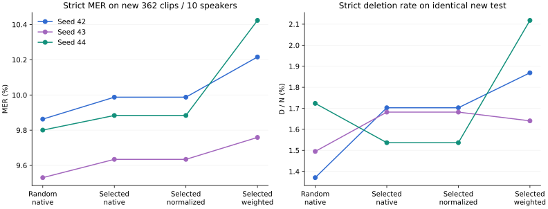
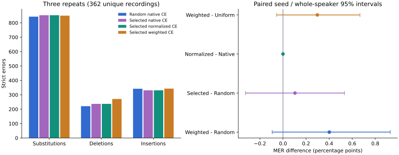

# Normalization and retention-weight ablation

2026-10-22 task date; protocol and directory retain the 2026-10-21 freeze date. Completed 12 fresh SFTs from the fixed base, each 500 examples/63 steps, seeds42/43/44. Fixed Random 500 / Selected 500, known dev 52, new test: 362 recordings/10 current-role-separated speaker IDs. Test N=4816 reference tokens; three repeated model evaluations are not 1086 independent recordings. Original references and strict scorer remain unchanged.

Fixed-base single run: MER 9.7799%, S/D/I=275/101/95, N=4816. This is one fixed decoding run, not three base-model training seeds.

## New-test results

| Arm | Seed42 MER% | Seed43 | Seed44 | Mean MER% | Three-repeat S/D/I |
|---|---:|---:|---:|---:|---|
| Random native CE | 9.8630 | 9.5307 | 9.8007 | 9.7315 | 843/221/342 |
| Selected native CE | 9.9875 | 9.6346 | 9.8837 | 9.8353 | 853/237/331 |
| Selected normalized CE | 9.9875 | 9.6346 | 9.8837 | 9.8353 | 853/237/331 |
| Selected weighted CE | 10.2159 | 9.7591 | 10.4236 | 10.1329 | 850/271/343 |

| Contrast (right minus left) | Mean MER delta pp | Paired95% interval pp | Seed deltas pp |
|---|---:|---|---|
| joint | +0.4014 | [-0.0937, +0.9297] | +0.3530, +0.2284, +0.6229 |
| selection | +0.1038 | [-0.3246, +0.5328] | +0.1246, +0.1038, +0.0831 |
| normalization | +0.0000 | [+0.0000, +0.0000] | +0.0000, +0.0000, +0.0000 |
| weights | +0.2976 | [-0.0556, +0.6673] | +0.2284, +0.1246, +0.5399 |

Normalization and weights are the two primary contrasts. Selection and joint are secondary. These are paired crossed resamplings of 3 training seeds and 10 whole speakers, 5000 replicates, seed 20261020. Intervals are exploratory and unadjusted across comparisons. See [aggregate evidence](SUMMARY.json), [design](DESIGN.md) and [deletion diagnosis](REGRESSION_ANALYSIS.md).

## Interpretation and next steps

The native and uniform controls produce **identical learned weights and all dev/test transcriptions in every seed**. Actual training logs give exactly8x pre-clipping norm ratios for each of 62 full windows and 4x for the last window; all 189 updates per arm exceed the clipping cap1. This explains why smaller logged losses do not imply different learned models in this configuration. Saved tokenizer padding reloads left versus right; all 1242 actual batch1 input pairs match. Arbitrary ragged batches remain unverified.

Selected data has more total edits than Random in all 3 seeds (+6/+5/+4). Weighting has more edits than the uniform control in all 3 (+11/+6/+26), totaling **S−3/D+34/I+12**. Both paired intervals cross zero; this pilot supports neither a reliable selection advantage nor adoption of2x weights. The mixed-language group is the largest weighting regression. Filler-token D decreases15→13, while other-token D increases206→243; that is not a content-retention repair.

All 9 original-arm final weight hashes reproduce the prior study exactly despite fresh execution. The previous test280 selection delta−0.4067pp becomes+0.1038pp on these new 362 recordings. These are different cohorts, not a training improvement; no post-hoc pooling is used. The current test is now observed.

Next, standardize saved padding in a separate version and verify unequal-length batched inputs. Review known train/dev references, contractions, repetitions and content omissions with audio before another objective change. Any later quality claim needs another frozen evaluation cohort; do not tune on these 362 recordings or turn their tokens into a training whitelist. Human listening remains pending.

## Language and lexical coverage

All values below are mean strict MER%. Rare frequency2+ has only 7 clips and repetition2+ only 11; do not infer a general benefit from those cells.

| Group | Unique clips | Random native CE | Selected native CE | Selected normalized CE | Selected weighted CE |
|---|---:|---:|---:|---:|---:|
| language / zh | 190 | 6.0471 | 6.3660 | 6.3660 | 6.3774 |
| language / mixed | 93 | 13.5182 | 13.2434 | 13.2434 | 14.1179 |
| language / en | 79 | 20.0601 | 19.9399 | 19.9399 | 20.3604 |
| filler_present | 81 | 11.6536 | 12.0604 | 12.0604 | 12.3511 |
| filler_absent | 281 | 9.1306 | 9.1396 | 9.1396 | 9.4394 |
| frequency / 2+ | 7 | 11.4219 | 12.5874 | 12.5874 | 12.5874 |
| repetition / 2+ | 11 | 11.9565 | 10.6884 | 10.6884 | 11.9565 |

## Why this control was required

The pinned native model is detected as accepting loss kwargs, but its thinker does not forward num_items_in_batch to the CE function. A real-Trainer scalar backward check gives pre-clipping ratios 8x for full windows and 4x for the final partial window. The pinned ASR model’s all-ones forward CE matches exactly. Sixteen FP32/BF16 mask/length checks give maximum forward difference 2.3842e-7 and identical gradients. This is numerical loss evidence, not ASR quality or an effective Adam LR multiplier.

All 189 optimizer updates per prior arm exceeded max_grad_norm 1; clipping can cancel much of the scale effect. Uniform uses the exact retention adapter with no eligible span lists: all valid target weights1,0 boosted subwords. Weighted uses the unchanged original sidecar:369 boosted training subwords. Both retain identical 500 ordered selected records/targets, 52 known dev examples, and 63 actual optimizer updates. The adapter declares an optional2x rule in both audits; the uniform control never activates it.

All base plus 12 dev reloads finished before opening the new test. No best seed/checkpoint, new learning rate, selector retuning or test-word whitelist was used. Current-role speakers are disjoint; these IDs have historical project exposure, prior glossary read all official train texts, and conversation/base-pretraining independence is unknown. 18 test references contain source UNK. Human listening is pending.

## Development panel (known, not independent test)

| Arm | Dev52 mean MER% | Primary40 | Challenge12 |
|---|---:|---:|---:|
| Random native CE | 12.4909 | 14.5246 | 7.8571 |
| Selected native CE | 11.6195 | 13.5841 | 7.1429 |
| Selected normalized CE | 11.6195 | 13.5841 | 7.1429 |
| Selected weighted CE | 12.4909 | 14.1066 | 8.8095 |

On known dev, weighted minus uniform three-repeat edit changes are S=+14, D=-4, I=+2. Fewer D alone is not recovered content when total edits rise. This is development evidence, not an independent-test claim.

[Validation](VALIDATION.md) · [Reproduction](REPRODUCE.md) · [Frozen protocol](../../NORMALIZATION_PROTOCOL.md). Offline subprocess timings include load/train or load-to-final-transcript and are not streaming first text/TTS/sound, real microphone or strict cold-start measures. No deployment, agents, Git commit/push or apex access.
